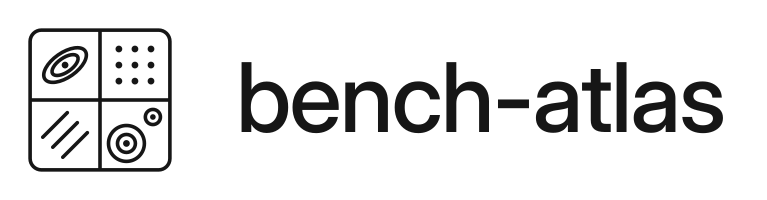

<p align="center">
  <picture>
    <source media="(prefers-color-scheme: dark)" srcset="assets/bench-atlas-lockup-dark.svg">
    <source media="(prefers-color-scheme: light)" srcset="assets/bench-atlas-lockup-light.svg">
    
  </picture>
</p>

Tools for analysing and comparing continuous black-box optimization benchmarks:
ELA, LON, diversity, cost and algorithm discrimination.

> Early development — the CLI subcommands are placeholders for now.

## Installation

```bash
uv sync
```

## Usage

```bash
uv run bench-atlas --help
```

Planned subcommands: `ela`, `lon`, `timing`, `run`, `metrics`, `report`.

## Development

```bash
uv sync                       # install the package with dev dependencies
uv run pre-commit install     # enable git hooks
uv run pre-commit run --all-files
uv run pytest
```

## License

MIT
