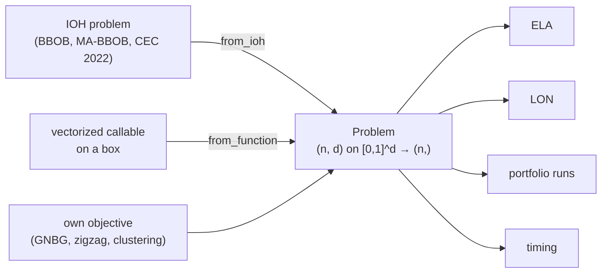

# Problems

bench-atlas does not use the problem classes of the benchmark libraries
directly. Every function, whatever its source, is wrapped in one small
abstraction so that all analyses treat all suites the same way.

## One shape for every function

A [`Problem`](reference/problems.md#bench_atlas.problems.Problem) is a
**minimization problem on the unit cube** $[0, 1]^d$:

- **Batch only.** It is called with points of shape `(n, d)` and returns `(n,)`.
  Both shapes are checked; there are no single-point calls.
- **Unit cube.** Original domains (BBOB's $[-5, 5]^d$, GNBG's $[-100, 100]^d$, ...)
  are mapped linearly to $[0, 1]^d$, so sample sizes, step sizes and budgets mean
  the same thing on every suite.
- **Stable id.** `ProblemId(suite, function, instance, dimension)` prints as
  `bbob_f7_i4_d5` and is the key every result table is joined on.
- **Known optimum, if any.** `x_opt` (on $[0, 1]^d$) and `f_opt` are optional and
  independent of each other.
- **Evaluation counter.** `evaluations` counts every evaluated point and is what
  budgets are enforced on.



## Building problems

```python
import numpy as np
from bench_atlas.problems import ProblemId, from_function

sphere = from_function(
    lambda x: (x**2).sum(axis=1),  # vectorized, on the original box
    id=ProblemId("toy", 1, 1, 3),
    lb=-5.0,
    ub=5.0,
    f_opt=0.0,
)
sphere(np.full((1, 3), 0.5))  # array([0.])
```

IOH problems are wrapped with
[`from_ioh`](reference/problems.md#bench_atlas.problems.from_ioh); the result is
bitwise identical to calling IOH at the mapped points (this is tested).

## Parallel workers

Problems are picklable plain dataclasses, so they can be sent to process
workers. Each pickled copy counts its own evaluations, so budgets are enforced
inside the worker. A problem is never shared between threads.
